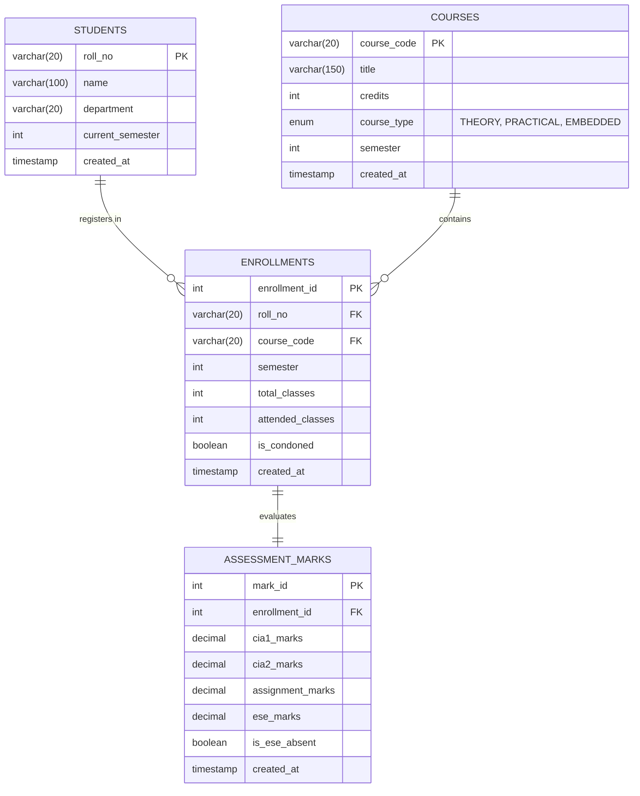

# 🎓 Student Academic & Continuous Evaluation System
### Kongu Engineering College (Autonomous) — Regulation 2024 (R2024)
**End-to-End Academic Evaluation, Attendance Tracking, CIA/ESE Phased Assessment & SGPA Engine**

---

<p align="center">
  
  
  
  
  
  
  
</p>

---

## ⚡ Direct Downloads (One-Click Video & Document Access)

Click any of the cards or badges below to **directly download** the demonstration video or comprehensive evaluation documents:

<div align="center">

| 🎬 Demonstration Video | 📄 Project Report (PDF) | 📝 Project Report (Word DOCX) |
| :---: | :---: | :---: |
| <a href="https://github.com/MurasoliB/Student_Evaluation_Using_Java_JDBC/raw/main/VIDEO/Murasoli%20B%2025ITL188.mp4" target="_blank" title="Click to Download Video Demonstration"></a> | <a href="https://github.com/MurasoliB/Student_Evaluation_Using_Java_JDBC/raw/main/DOCUMENTS/JAVA%20ASSIGNMENT-MURASOLI%20B%2025ITL188%20(%20perfect%20Final).pdf" target="_blank" title="Click to Download Report PDF"></a> | <a href="https://github.com/MurasoliB/Student_Evaluation_Using_Java_JDBC/raw/main/DOCUMENTS/JAVA%20ASSIGNMENT-MURASOLI%20B%2025ITL188%20(%20perfect%20Final).docx" target="_blank" title="Click to Download Report DOCX"></a> |
| **`Murasoli B 25ITL188.mp4`**<br/>*(Full walkthrough of CLI, GUI, and Database)* | **`JAVA ASSIGNMENT-MURASOLI B 25ITL188 ( perfect Final).pdf`**<br/>*(Complete final documentation & calculation breakdown)* | **`JAVA ASSIGNMENT-MURASOLI B 25ITL188 ( perfect Final).docx`**<br/>*(Editable Microsoft Word version)* |
| [🔗 Direct Raw Link](https://github.com/MurasoliB/Student_Evaluation_Using_Java_JDBC/raw/main/VIDEO/Murasoli%20B%2025ITL188.mp4) &bull; [👁️ View Online](https://github.com/MurasoliB/Student_Evaluation_Using_Java_JDBC/blob/main/VIDEO/Murasoli%20B%2025ITL188.mp4) | [🔗 Direct Raw Link](https://github.com/MurasoliB/Student_Evaluation_Using_Java_JDBC/raw/main/DOCUMENTS/JAVA%20ASSIGNMENT-MURASOLI%20B%2025ITL188%20(%20perfect%20Final).pdf) &bull; [👁️ View Online](https://github.com/MurasoliB/Student_Evaluation_Using_Java_JDBC/blob/main/DOCUMENTS/JAVA%20ASSIGNMENT-MURASOLI%20B%2025ITL188%20(%20perfect%20Final).pdf) | [🔗 Direct Raw Link](https://github.com/MurasoliB/Student_Evaluation_Using_Java_JDBC/raw/main/DOCUMENTS/JAVA%20ASSIGNMENT-MURASOLI%20B%2025ITL188%20(%20perfect%20Final).docx) |

</div>

> **Note:** Clicking the red **"CLICK TO DOWNLOAD"** button above triggers an immediate browser download of the high-definition MP4 video demonstration directly from GitHub.

---

## 📌 Executive Summary

The **Student Academic & Continuous Evaluation System** is an enterprise-grade academic grading and evaluation solution developed in **Java (JDBC)** and **MySQL**, adhering strictly to the **Kongu Engineering College (Autonomous) Regulation 2024 (R2024)** academic standards.

The application automates the entire evaluation life cycle across all **8 semesters and 8 engineering disciplines** (IT, CSE, ECE, EEE, MECH, CIVIL, AIML/AIDS, CHEM):
1. **Phased Continuous Assessment (CIA):** Tracks CIA Test 1, CIA Test 2, and Continuous Formative Assessments (Assignments / Seminars / Lab Quizzes) incrementally across the academic term.
2. **Category-Aware Weightage Splitting:** Implements differential CIA:ESE weightage ratios for **Theory (40:60)**, **Practical (60:40)**, and **Embedded Theory + Practical (50:50)** courses.
3. **Automated Attendance Audit & Condonation Workflow:** Enforces strict compliance ($\ge 75\%$ eligible, $65\% \text{ to } 74.9\%$ medical condonation prerequisite, $<65\%$ automatic Shortage of Attendance — `SA` barring).
4. **End Semester Examination (ESE) & Minimum Passing Thresholds:** Evaluates separate ESE cutoffs ($45\%$ Theory/Embedded, $50\%$ Practical) and overall minimum passing aggregate ($50\%$).
5. **10-Point Absolute Letter Grading & SGPA Calculation:** Computes Semester Grade Point Average (SGPA) and converted percentage using strict weighted credit formulas.
6. **Dual-Interface Operation:** Offers both an interactive **ANSI Terminal Command-Line Interface (CLI)** and a sleek, modern **Glassmorphism Web Dashboard (GUI)** with real-time analytics.

---

## 🛠️ Complete Tech Stack

| Domain | Technologies / Frameworks | Purpose & Highlights |
| :--- | :--- | :--- |
| **Programming Language** | **Java SE 17 / 21 (LTS)** | Object-Oriented Architecture, Strong Type Safety, Data Transfer Objects (DTOs), DAO Pattern |
| **Database Connectivity** | **JDBC (Java Database Connectivity)** | PreparedStatements, Transaction Safety, Batch Updates, SQL Injection Prevention |
| **Relational Database** | **MySQL 8.0 / 8.4** | InnoDB Storage Engine, Normalized Relational Schema, Foreign Key Constraints (`CASCADE`), Indexes |
| **JDBC Driver** | **MySQL Connector/J 8.x** (`mysql-connector-j-8.x.jar`) | High-performance Type-4 JDBC Driver |
| **HTTP Server & REST API** | **`com.sun.net.httpserver.HttpServer`** | Built-in zero-dependency lightweight Java Web Server handling JSON REST endpoints |
| **Frontend UI (Dashboard)** | **HTML5 & Modern CSS3** | Glassmorphic cards, responsive flex/grid layouts, clean typography (`Outfit` & `Plus Jakarta Sans`) |
| **CSS Framework** | **Tailwind CSS (CDN)** | Utility-first responsive styling and layout system |
| **Data Visualization** | **Chart.js 4.x** | Interactive grade distribution bar charts & department performance radars |
| **Iconography & Badges** | **FontAwesome 6.5 & Shields.io** | High-definition vector icons and dynamic GitHub status badges |
| **Scripting & Automation** | **Windows Batch (`.bat`) & PowerShell (`.ps1`)** | One-click compilation, database schema migration, console & web launcher scripts |

---

## 📐 Academic Evaluation Architecture (KEC R2024 Rules)

```
                            ┌───────────────────────────────────┐
                            │    Student Enrolled in Course     │
                            └─────────────────┬─────────────────┘
                                              │
                                   [ Attendance Check ]
                                              │
                      ┌───────────────────────┴───────────────────────┐
                      ▼                                               ▼
              Attendance < 65%                                Attendance >= 65%
            ┌──────────────────┐                                      │
            │  Shortage: 'SA'  │                      ┌───────────────┴───────────────┐
            │  (Grade Point: 0)│                      ▼                               ▼
            │ (Barred from ESE)│             65% <= Attn < 75%                  Attn >= 75%
            └──────────────────┘                      │                               │
                                            [ Condonation Paid? ]                     │
                                            ┌─────────┴─────────┐                     │
                                            ▼                   ▼                     │
                                          No: 'SA'          Yes: Eligible             ▼
                                                             └──────────────► [ Eligible for ESE ]
                                                                                      │
                                                                           [ Compute CIA + ESE ]
                                                                                      │
                                                                           [ Check Thresholds ]
                                                                                      │
                                                             ┌────────────────────────┴────────────────────────┐
                                                             ▼                                                 ▼
                                                   Failed ESE or Total < 50                         Passed (Total >= 50)
                                                             │                                                 │
                                                      Grade: 'RA' (0)                                 10-Point Scale Mapping
                                                                                                      (O, A+, A, B+, B)
```

### 1. Course Categories & Weightages

| Course Type | CIA Weightage | ESE Weightage | ESE Passing Threshold (Raw) | Aggregate Passing Mark |
| :--- | :---: | :---: | :---: | :---: |
| **THEORY** | **40%** | **60%** | $\ge 45\%$ (27.0 / 60) | $\ge 50\%$ |
| **PRACTICAL** | **60%** | **40%** | $\ge 50\%$ (20.0 / 40) | $\ge 50\%$ |
| **EMBEDDED** (Theory + Lab) | **50%** | **50%** | $\ge 45\%$ (22.5 / 50) | $\ge 50\%$ |

### 2. CIA Internal Assessment Breakdown (100% Internal Scale)
$$\text{CIA}_{\text{raw}} = (0.35 \times \text{CIA}_1) + (0.35 \times \text{CIA}_2) + (0.30 \times \text{Assignment/Quizzes/Lab})$$
$$\text{Scaled CIA} = \frac{\text{CIA}_{\text{raw}} \times \text{CIA Weightage}}{100}$$

### 3. Attendance & Eligibility Rules
- **$\ge 75\%$:** Fully Eligible for End Semester Examination.
- **$65\% \text{ to } 74.9\%$:** Conditionally eligible upon approved medical / institutional condonation (`is_condoned = TRUE`).
- **$< 65\%$:** Strict Shortage of Attendance (`SA` Grade, 0 Grade Points). Barred from ESE; must re-register for the course.

### 4. 10-Point Absolute Grading System

| Total Marks Range | Letter Grade | Grade Point ($G_i$) | Academic Meaning |
| :---: | :---: | :---: | :--- |
| **91 – 100** | **O** | **10** | Outstanding |
| **81 – 90** | **A+** | **9** | Excellent |
| **71 – 80** | **A** | **8** | Very Good |
| **61 – 70** | **B+** | **7** | Good |
| **50 – 60** | **B** | **6** | Average / Passing |
| **< 50 or ESE Cutoff Not Met** | **RA** | **0** | Reappear (Fail) |
| **Attendance Deficit (< 65%)** | **SA** | **0** | Shortage of Attendance |
| **Absent in ESE Exam** | **AB** | **0** | Absent |

### 5. SGPA Calculation Formula
$$\text{SGPA} = \frac{\sum_{i=1}^{n} (C_i \times G_i)}{\sum_{i=1}^{n} C_i}$$
$$\text{Equivalent Percentage} = (\text{SGPA} - 0.75) \times 10$$

*(Where $C_i$ = Credits of $i^{\text{th}}$ Course, $G_i$ = Grade Point scored in $i^{\text{th}}$ Course)*

---

## 🗄️ Relational Database Schema

The database `kec_eval` follows a 3NF normalized schema with full foreign-key constraints, cascading actions, and domain check constraints:



---

## 💻 Dual Interface Capabilities

### 1. Interactive Web Dashboard (Browser GUI)
- **Real-Time Analytics:** Live student counts, department-wide pass rates, average SGPA, and defaulter metrics.
- **Dynamic Semester Switcher:** Effortlessly switch between Semester 1 through Semester 8.
- **Live Search & Status Filtering:** Instant client-side filtering by roll number, name, or pass/fail/defaulter status.
- **Interactive Mark Entry & Attendance Condonation:** Update CIA 1, CIA 2, Assignment, and ESE marks with instant recalculation.
- **Official Printable Grade Sheet:** Professional university mark sheet modal with print/save as PDF support.

### 2. ANSI Terminal CLI (`MainApp.java`)
- **Menu Options 1–9:**
  1. Student Registration (Add new student with roll number and branch)
  2. Course Catalog Browser (List all courses by semester and category)
  3. Course Enrollment & Attendance Tracker
  4. Phased Marks Entry (Phase 1, Phase 2, Phase 3 with Absence toggle)
  5. Student Mark Sheet Generator (Detailed printable console grade card)
  6. Attendance Defaulters Report Generator
  7. Department-wise Performance Summary
  8. Automated Demonstration Proof (End-to-End pipeline)
  9. Launch Web Dashboard on Port 8080

---

## 📂 Project Repository Structure

```
├── DOCUMENTS/
│   ├── JAVA ASSIGNMENT-MURASOLI B 25ITL188 ( perfect Final).pdf    # Comprehensive PDF Documentation
│   └── JAVA ASSIGNMENT-MURASOLI B 25ITL188 ( perfect Final).docx   # Editable Word Document
├── VIDEO/
│   └── Murasoli B 25ITL188.mp4                                     # Full High-Definition Demo Video (60.7 MB)
├── SRC/
│   ├── assets/                                                    # Logos, icons, and schema diagrams
│   │   ├── kec_logo.png
│   │   ├── kec_icon.ico
│   │   └── flowchart_bw.png
│   ├── lib/
│   │   └── mysql-connector-j-8.x.jar                              # Official MySQL JDBC Connector Jar
│   ├── sql/
│   │   └── kec_schema.sql                                         # Complete SQL DDL + 80+ Students Sample Data
│   ├── src/
│   │   ├── DBConnection.java                                      # JDBC Connection Pool & Credential Manager
│   │   ├── AcademicDAO.java                                       # Evaluation Engine, SQL Queries & DTOs
│   │   ├── StudentDAO.java                                        # DAO Interface & Extensible Stubs
│   │   ├── MainApp.java                                           # Interactive CLI & Command Dispatcher
│   │   ├── WebDashboard.java                                      # Embedded HTTP Server & REST API Endpoints
│   │   ├── RunSchema.java                                         # Programmatic SQL Runner
│   │   └── SeedAllSemesters.java                                  # Full Batch Sample Data Seeder
│   ├── web/
│   │   ├── dashboard.html                                         # Responsive Single-Page Application (SPA)
│   │   ├── favicon.ico
│   │   └── kec_logo.png
│   ├── run.bat                                                    # Universal 1-Click Interactive Launcher
│   ├── console.bat                                                # Direct Command-Line CLI Launcher
│   └── mysql_cli.bat                                              # Quick MySQL Terminal Client Launcher
└── README.md                                                      # Project Documentation & Guide
```

---

## 🚀 Quick Start & Installation Guide

### Prerequisites
1. **Java Development Kit (JDK 17 or higher)**
   Verify installation:
   ```bash
   java -version
   javac -version
   ```
2. **MySQL Server (8.0 or higher)**
   Ensure MySQL service is active and running on `localhost:3306`.

---

### Step 1: Database Setup
Launch MySQL and execute the comprehensive schema provided in `SRC/sql/kec_schema.sql`:
```bash
mysql -u root -p < "SRC/sql/kec_schema.sql"
```
*Alternatively, you can run `SRC/src/RunSchema.java` or run the included `mysql_cli.bat`.*

---

### Step 2: Database Credentials Configuration
Check and adjust your MySQL password in `SRC/src/DBConnection.java` if needed:
```java
private static final String DEFAULT_HOST = "localhost";
private static final String DEFAULT_PORT = "3306";
private static final String DEFAULT_DB   = "kec_eval";
private static final String DEFAULT_USER = "root";
private static final String DEFAULT_PASS = "0000"; // Update with your MySQL password
```
*(Environment variables `DB_HOST`, `DB_PORT`, `DB_NAME`, `DB_USER`, and `DB_PASSWORD` can also be used)*

---

### Step 3: Run the Application (One-Click)

#### Option A: Universal Launcher (Recommended)
Double-click `SRC/run.bat` or execute in terminal:
```bat
cd SRC
run.bat
```
Select from the interactive menu:
- `[1]` Launch Interactive Web Dashboard (`http://localhost:8080`)
- `[2]` Launch Command Prompt Console Menu
- `[3]` Run Automated Demonstration Proof

#### Option B: Launch Web Dashboard Directly
```bat
cd SRC
run.bat web
```
Then open your favorite browser at **[http://localhost:8080](http://localhost:8080)**.

#### Option C: Launch CLI Console Directly
```bat
cd SRC
console.bat
```

---

## 📊 Sample Output Preview

### Attendance Defaulters Report & SGPA Sheet


```
========================================================================================================================
                                KONGU ENGINEERING COLLEGE (AUTONOMOUS) - REGULATION 2024
                                     SEMESTER GRADE SHEET - END SEMESTER EXAMINATION
========================================================================================================================
 Roll No    : 24ITR001                       Student Name : Arun Kumar S
 Department : IT                             Semester     : 3
------------------------------------------------------------------------------------------------------------------------
 Course Code | Course Title                  | Type      | Attn% | Status   | CIA(Scaled) | ESE(Scaled) | Total | Grade | Pt
------------------------------------------------------------------------------------------------------------------------
 24ITT31     | Advanced Data Structures      | THEORY    | 92.5% | ELIGIBLE |    36.40    |    54.00    | 90.40 |  A+   | 9
 24ITT32     | Computer Organization         | THEORY    | 88.0% | ELIGIBLE |    34.80    |    51.60    | 86.40 |  A+   | 9
 24ITT33     | Programming in Java           | EMBEDDED  | 95.0% | ELIGIBLE |    46.50    |    45.50    | 92.00 |  O    | 10
 24ITL31     | Data Structures Laboratory    | PRACTICAL | 96.0% | ELIGIBLE |    57.60    |    36.00    | 93.60 |  O    | 10
 24ITL32     | Java Programming Laboratory   | PRACTICAL | 94.0% | ELIGIBLE |    55.80    |    37.20    | 93.00 |  O    | 10
------------------------------------------------------------------------------------------------------------------------
 Total Enrolled Credits : 21      Total Credits Earned : 21
 Total Grade Points     : 198.00  SGPA                 : 9.43 / 10.00
 Equivalent Percentage  : 86.80%  Overall Result       : PASS
========================================================================================================================
```

---

## 👨‍💻 Author & Project Credits

- **Candidate Name:** Murasoli B
- **Roll Number:** `25ITL188`
- **Institution:** Kongu Engineering College (Autonomous), Perundurai, Erode — 638 060
- **Academic Regulation:** Autonomous Regulation 2024 (R2024)
- **Repository:** [MurasoliB/Student_Evaluation_Using_Java_JDBC](https://github.com/MurasoliB/Student_Evaluation_Using_Java_JDBC)
- **Video Download:** [Murasoli B 25ITL188.mp4](https://github.com/MurasoliB/Student_Evaluation_Using_Java_JDBC/raw/main/VIDEO/Murasoli%20B%2025ITL188.mp4)
- **Project Documentation:** [Download PDF](https://github.com/MurasoliB/Student_Evaluation_Using_Java_JDBC/raw/main/DOCUMENTS/JAVA%20ASSIGNMENT-MURASOLI%20B%2025ITL188%20(%20perfect%20Final).pdf) &bull; [Download DOCX](https://github.com/MurasoliB/Student_Evaluation_Using_Java_JDBC/raw/main/DOCUMENTS/JAVA%20ASSIGNMENT-MURASOLI%20B%2025ITL188%20(%20perfect%20Final).docx)

---
*Developed with ❤️ as part of the Java Programming & Relational Database Connectivity (JDBC) Academic Project.*
